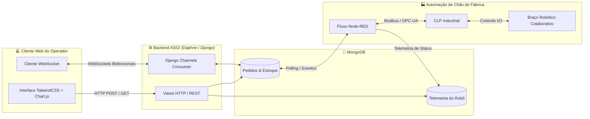

<div align="center">

# 🤖 RoboFlow MES
### Sistema de Execução de Manufatura e Telemetria em Tempo Real para Robótica Colaborativa

[](https://python.org)
[](https://djangoproject.com)
[](https://mongodb.com)
[](https://tailwindcss.com)
[](https://nodered.org)
[](LICENSE)

**🌐 Leia em outros idiomas:** [🇺🇸 English (EN)](README.md)

</div>

---

## 🎯 Visão Geral e Problema Resolvido

Em ambientes modernos de manufatura inteligente (**Indústria 4.0**), conectar a tecnologia operacional de chão de fábrica (CLPs e robôs colaborativos) à gestão de produção via web é essencial para garantir visibilidade e agilidade.

O **RoboFlow MES** é um sistema web full-stack de execução de manufatura (MES) desenvolvido com **Django, Django Channels (WebSockets), MongoDB e Node-RED**. Ele permite que operadores configurem ordens de montagem em múltiplos estágios por meio de uma interface responsiva, despachem filas de produção para um robô colaborativo controlado por CLP e acompanhem o estado da máquina, níveis de estoque e telemetria de pedidos em tempo real—sem necessidade de recarregar a página.

---

## 🏗️ Arquitetura do Sistema



---

## ✨ Destaques de Engenharia

* **⚡ Atualizações em Tempo Real Orientadas a Eventos (WebSockets):** Com **Django Channels** e **Daphne ASGI**, a criação de pedidos, transições de status (`Pendente` → `Em Andamento` → `Concluído`), alertas de estoque e notificações in-app são transmitidos instantaneamente a todos os terminais conectados.
* **🤖 Integração IIoT Bidirecional & Simulador de CLP Integrado:** Integra-se ao **Node-RED** e **MongoDB** (coleção `dashboard_robo`) para enfileirar matrizes de montagem 3x3 para execução pelo CLP enquanto monitora estados ao vivo do robô (`Ocioso`, `Em Montagem`, `Erro`). Inclui um botão interativo **Simular CLP** no dashboard para testar transições em tempo real sem necessidade do hardware físico conectado.
* **🧩 Configurador Interativo de Montagens:** Construtor visual que permite configurar 3 submontagens por pedido (9 peças geométricas no total: Círculo, Quadrado e Hexágono), com pré-visualização da pilha (Base, Meio, Topo), validação instantânea contra peças duplicadas e preenchimento automático de exemplo.
* **📊 Métricas de Produção & Auditoria Histórica:** Gráficos temporais interativos com **Chart.js** (vazão de 7 dias, 30 dias e mês atual), busca instantânea, filtros rápidos por pílulas de status e modal acessível de inspeção de montagens.
* **♿ Interface Responsiva e Acessível:** Construído com TailwindCSS, regiões `aria-live`, navegação completa por teclado (`Enter`, `Space`, `Escape`), tooltips dinâmicos e notificações Toast.

---

## 🧰 Tecnologias Utilizadas

| Camada | Tecnologias |
| :--- | :--- |
| **Backend & Tempo Real** | Python 3.12, Django, Django Channels 4.2 (WebSockets), Daphne 4.2 (ASGI), Djongo / PyMongo |
| **Frontend** | HTML5, TailwindCSS, Módulos ES6 Vanilla, Chart.js, FontAwesome |
| **Banco de Dados & IIoT** | MongoDB, Node-RED, Controlador Lógico Programável (CLP) |
| **Testes Automatizados** | Django TestCase, `unittest.mock` (`AsyncMock` para camadas de canal WebSocket) |

---

## 🚀 Como Rodar o Projeto Localmente

### Pré-requisitos
* **Python 3.12+**
* **MongoDB** (Instância local na porta `27017`, Docker ou URI do MongoDB Atlas)

### 1. Clonar e Configurar o Ambiente
```bash
git clone https://github.com/cunhanina/roboflow-mes.git
cd roboflow-mes

python -m venv venv
source venv/bin/activate  # No Windows: venv\Scripts\activate
pip install -r requirements.txt
```

Copie o arquivo de variáveis de ambiente de exemplo:
```bash
cp .env.example .env
```

### 2. Iniciar o MongoDB (via Docker Compose ou Serviço Local)
Caso não tenha o MongoDB instalado localmente, suba um container com um único comando:
```bash
docker compose up -d
```

### 3. Executar Migrações e Popular Dados de Demonstração
```bash
python manage.py makemigrations dashboard
python manage.py migrate
python manage.py seed_demo
```
*(O comando `seed_demo` cadastra as 3 peças padrão, gera 14 dias de histórico de pedidos para o gráfico analítico e cria um pedido na fila para explorar o dashboard imediatamente.)*

### 4. Iniciar o Servidor ASGI
```bash
python manage.py runserver
```
Acesse **`http://127.0.0.1:8000/`** no seu navegador.

---

## 🧪 Executando os Testes

```bash
python manage.py test dashboard
```

---

## 📂 Estrutura do Projeto

```text
roboflow-mes/
├── manage.py                          # Utilitário CLI do Django
├── requirements.txt                   # Dependências Python
├── docker-compose.yml                 # Container MongoDB para desenvolvimento local
├── .env.example                       # Modelo de variáveis de ambiente
├── setup/                             # Configuração global ASGI/WSGI e Django
│   ├── asgi.py                        # ProtocolTypeRouter (HTTP + WebSocket)
│   ├── settings.py                    # Configurações de ambiente e banco de dados
│   └── urls.py                        # Rotas principais (incluindo /admin/)
└── dashboard/                         # Aplicação principal do MES
    ├── admin.py                       # Painel Admin para Peça, Pedido e Notificação
    ├── consumers.py                   # AsyncWebsocketConsumer para telemetria em tempo real
    ├── models.py                      # Modelos de dados e serializadores
    ├── routing.py                     # Rotas WebSocket (/ws/dashboard/)
    ├── views.py                       # Endpoints REST e controladores de páginas
    ├── tests.py                       # Testes unitários e de integração
    ├── management/commands/
    │   └── seed_demo.py               # Comando CLI para popular estoque e pedidos demo
    ├── templates/                     # Templates HTML (base, home, novoPedido, historico)
    └── static/                        # JavaScript modular ES6 e estilização customizada
        ├── style.css
        └── js/
            ├── main.js
            └── modules/               # charts, constants, modals, newOrder, notifications, utils
```

---

## 📄 Licença

Distribuído sob a **MIT License**. Veja o arquivo [LICENSE](LICENSE) para mais detalhes.
