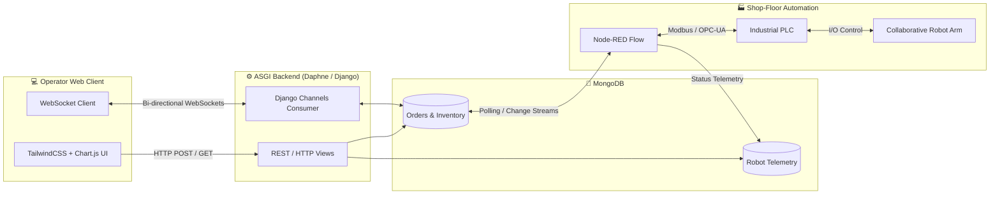

<div align="center">

# 🤖 RoboFlow MES
### Real-Time Industrial Order Dispatch & Telemetry System for Collaborative Robotics

[](https://python.org)
[](https://djangoproject.com)
[](https://mongodb.com)
[](https://tailwindcss.com)
[](https://nodered.org)
[](LICENSE)

**🌐 Read in other languages:** [🇧🇷 Português (BR)](README(PT-BR).md)

</div>

---

## 🎯 Overview & Problem Statement

In modern smart manufacturing (**Industry 4.0**), bridging shop-floor operational technology (PLCs and collaborative robots) with web-based production management is essential for operational visibility and agility.

**RoboFlow MES** is a full-stack Manufacturing Execution System dashboard built with **Django, Django Channels (WebSockets), MongoDB, and Node-RED**. It enables operators to configure multi-stage part assemblies via a responsive web interface, dispatches production queues to a PLC-controlled collaborative robot, and streams live machine state, inventory levels, and order telemetry back to the browser in real time—without page reloads.

---

## 🏗️ System Architecture



---

## ✨ Key Engineering Highlights

* **⚡ Event-Driven Real-Time Updates (WebSockets):** Powered by **Django Channels** and **Daphne ASGI**, order creation, status transitions (`Pending` → `In Progress` → `Completed`), part inventory, and in-app notifications broadcast instantaneously to all connected operator terminals.
* **🤖 Bidirectional IIoT & Built-In PLC Simulator:** Integrates with **Node-RED** and **MongoDB** (`dashboard_robo` collection) to queue 3x3 assembly matrices for PLC execution while monitoring live robot states (`Ocioso`, `Em Montagem`, `Erro`). Includes an interactive **Simulate PLC Cycle** control on the dashboard so reviewers can test real-time WebSocket transitions without physical hardware.
* **🧩 Interactive Assembly Configurator:** Visual builder allowing operators to configure 3 sub-assemblies per work order (9 geometric parts total: Circle, Square, Hexagon) with live stack previews, instant duplicate-shape validation, and one-click random valid order generation.
* **📊 Production Analytics & Historical Audit:** Interactive **Chart.js** time-series visualizations (7-day, 30-day, and monthly throughput) paired with instant client-side search, quick status filter pills, URL deep-linking, and keyboard-accessible assembly inspection modals.
* **♿ Accessible & Responsive UI:** Built mobile-first with TailwindCSS, semantic ARIA live regions, keyboard navigation (`Enter`, `Space`, `Escape`), custom tooltips, and toast feedback notifications.

---

## 🧰 Tech Stack

| Layer | Technologies |
| :--- | :--- |
| **Backend & Real-Time** | Python 3.12, Django, Django Channels 4.2 (WebSockets), Daphne 4.2 (ASGI), Djongo / PyMongo |
| **Frontend** | HTML5, TailwindCSS, Vanilla ES6 Modules, Chart.js, FontAwesome |
| **Database & IIoT** | MongoDB, Node-RED, Programmable Logic Controller (PLC) |
| **Testing** | Django TestCase, `unittest.mock` (`AsyncMock` for WebSocket channel layers) |

---

## 🚀 Getting Started

### Prerequisites
* **Python 3.12+**
* **MongoDB** (Local instance on port `27017`, Docker, or MongoDB Atlas URI)

### 1. Clone & Set Up Environment
```bash
git clone https://github.com/cunhanina/roboflow-mes.git
cd roboflow-mes

python -m venv venv
source venv/bin/activate  # On Windows: venv\Scripts\activate
pip install -r requirements.txt
```

Copy the example environment file:
```bash
cp .env.example .env
```

### 2. Start MongoDB (via Docker Compose or Local Service)
If you don't have MongoDB installed locally, spin it up with Docker:
```bash
docker compose up -d
```

### 3. Run Migrations & Seed Demo Data
```bash
python manage.py makemigrations dashboard
python manage.py migrate
python manage.py seed_demo
```
*(The `seed_demo` command populates the 3 geometric part types, 14 days of historical orders for the analytics chart, and an active queue order so the dashboard is ready to explore immediately.)*

### 4. Start the ASGI Server
```bash
python manage.py runserver
```
Access the application at **`http://127.0.0.1:8000/`**.

---

## 🧪 Running Automated Tests

```bash
python manage.py test dashboard
```

---

## 📂 Project Structure

```text
roboflow-mes/
├── manage.py                          # Django CLI entrypoint
├── requirements.txt                   # Python dependencies
├── docker-compose.yml                 # Local MongoDB container setup
├── .env.example                       # Environment variable template
├── setup/                             # ASGI/WSGI & global Django configuration
│   ├── asgi.py                        # ProtocolTypeRouter (HTTP + WebSocket)
│   ├── settings.py                    # Environment & database settings
│   └── urls.py                        # Root URL routing (including /admin/)
└── dashboard/                         # Core MES application
    ├── admin.py                       # Django Admin configuration for Peca, Pedido, Notificacao
    ├── consumers.py                   # AsyncWebsocketConsumer for real-time telemetry
    ├── models.py                      # Peca, Pedido, and Notificacao schemas & serializers
    ├── routing.py                     # WebSocket URL patterns (/ws/dashboard/)
    ├── views.py                       # REST endpoints & template controllers
    ├── tests.py                       # Unit tests for models, views, and WS broadcasts
    ├── management/commands/
    │   └── seed_demo.py               # CLI command to populate demo inventory & orders
    ├── templates/                     # Django HTML templates (base, home, novoPedido, historico)
    └── static/                        # Modular ES6 JavaScript & custom styles
        ├── style.css
        └── js/
            ├── main.js
            └── modules/               # charts, constants, modals, newOrder, notifications, utils
```

---

## 🤝 Contributing

1. Fork the repository.
2. Create a feature branch (`git checkout -b feature/my-feature`).
3. Commit your changes using Conventional Commits (`git commit -m "feat: add feature X"`).
4. Push to the branch (`git push origin feature/my-feature`) and open a Pull Request.

---

## 📄 License

Distributed under the **MIT License**. See [LICENSE](LICENSE) for more information.
